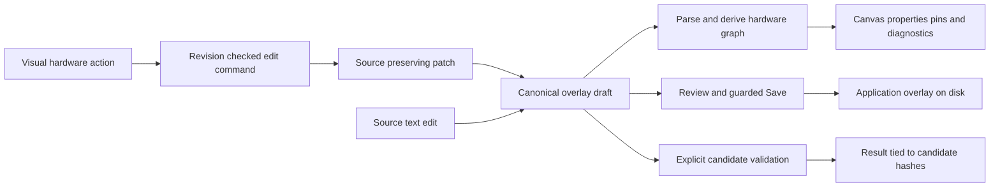

# Device Tree Editor master plan

Status: visual editor planned; D0–D3 complete within their staged scopes on
2026-11-05, with verification and measured limits recorded in their handoffs. The next product
priority is the visual Device Tree Editor
following the delivered everyday Project Creator workflow. This plan does not imply
that every advanced item in the Project Creator roadmap is complete. The editor's
runtime feature remains planned until its first usable editing workflow is delivered.

Build an offline visual hardware editor inside the existing `zephyr-utils` application.
Users open a project, select its exact configuration, place hardware modules, connect
buses and signals, assign pins, and configure peripherals. **Every hardware change in
the UI immediately adds, changes, or removes the corresponding overlay source in the
working draft.** A visible Save action writes the reviewed draft to the project.
Supported source edits update the visual representation in the other direction.

Implementation is divided into D0–D15. Each stage has an independent exit gate and a
copyable task prompt. Implement one requested stage at a time; this document is not an
instruction to implement the whole editor in one task.
The [foundation contract](device-tree-editor-contract.md),
[ADR 0019](decisions/0019-device-tree-editor-foundation.md), and
[D0 handoff](device-tree-editor-d0-handoff.md) record the adopted design and prototype
evidence. The [D1 handoff](device-tree-editor-d1-handoff.md) describes the injected
read-only workspace. The [D2 handoff](device-tree-editor-d2-handoff.md) records the
source engine, verification and measured limits. The [D3 handoff](device-tree-editor-d3-handoff.md)
records synchronized session drafts and unified undo. D4 is next.

## Product experience

The ordinary workflow should be:

1. Open an application from Projects or select an existing application directory.
2. Select a named configuration, exact board target and, when supported, image/domain.
3. See the board, peripherals, existing external devices, overlay stack, and selected
   editing file. Distinguish current source, draft changes, and last configured results.
4. Add a hardware module from a local catalogue or add a device from a binding. Choose
   its parent bus, address or chip select, required properties, and signal connections.
5. Assign pins using a pin table or supported board/connector diagram. Show resource
   conflicts and missing information at the control where the assignment happens.
6. Watch the overlay source and diff change immediately. Undo, redo, or edit source
   directly. Select a source construct to find its visual object and vice versa.
7. Review and Save. Run explicit configuration validation, resolve diagnostics, and
   optionally hand off to Projects for compilation.
8. Reopen the project and recover the same hardware configuration from ordinary source
   files, including changes made outside Utilities.

For example, adding an I2C sensor creates a child node under the selected controller;
changing its address updates that node's `reg`; connecting its interrupt creates the
appropriate GPIO specifier. Removing that newly added sensor removes its declarations
and only the dependencies that are demonstrably exclusive to it. A shared bus remains.
The exact syntax and legal values come from the selected environment and supported
adapters, not a fixed example copied into every project.

Nordic's Devicetree Visual Editor is the interaction reference: its documentation
describes live synchronization between visual edits and source, with saving from either
view. Adopt that interaction principle within this application's browser architecture.
The module canvas and staged contracts below are our proposed design, not claims about
Nordic's feature set. See [Nordic's editor guide](https://docs.nordicsemi.com/r/bundle/nrf-connect-vscode/page/guides/work_with_devicetree_editor.html).

### Workspace layout

| Area | Contents and interaction |
| --- | --- |
| Context bar | Application, configuration, exact target, domain, overlay destination, unsaved state, Save, Validate and Build |
| Left panel | Searchable devices/tree and hardware-module catalogue; filter by bus, compatible and supported capability |
| Main view | Logical module/bus canvas, peripheral list, or supported pin/connector view; synchronized selection |
| Property panel | Binding-aware fields, signal assignment, inherited/current/draft values, origin and actionable diagnostics |
| Source panel | Editable overlay, changes diff, source locations and validation messages; reachable without scrolling past the workspace |

The canvas describes logical hardware connections, not PCB placement or electrical
simulation. Moving a card changes layout metadata only. Connecting a signal or changing
a property changes source. Pin numbers on a package, GPIO port/index pairs, and board
header positions are separate identities with explicit mappings.

Use shared `--app-*` tokens. Provide keyboard and form/list equivalents for every drag
operation. At narrow widths, use navigable panels rather than shrinking a multi-pane
desktop layout. Save reviews retain their primary action, Escape handling and focus
return. Background validation updates never move focus or scroll.

## Scope and support policy

The complete editor means a complete load–edit–save–validate workflow for a published
support matrix. It does not mean that every Zephyr SoC has a verified package drawing
or that arbitrary preprocessor code can be edited graphically.

| Capability | First supported delivery | Expansion and fallback |
| --- | --- | --- |
| Project loading | Registered/imported workspace applications, one configuration and image | Explicit per-image contexts in D14; unsupported contexts remain inspectable |
| Durable source | One selected application overlay, preserving handwritten content | Coordinated multiple application fragments in D12 |
| Source constructs | Literals, nodes, label/path references and precisely attributable overrides | Preserve macros/includes/conditionals; restrict only edits whose meaning or span is ambiguous |
| Properties | Status and simple properties, then binding-aware types and references | Generic source editing for unsupported forms |
| Buses and devices | UART, I2C, SPI, GPIO LEDs/buttons and binding-selected child devices | Additional peripheral families in D11 |
| Pins | Generic GPIO specifiers; one tested Nordic pinctrl adapter in D8 | Verified connector maps and a second family in D13; no invented maps |
| Hardware modules | Local versioned recipes for a small tested set of devices | Data-only custom recipes; no automatic downloads or executable recipe hooks |
| Validation | Local syntax/structural checks, then explicit selected-environment configuration | Compilation through Projects; hardware operation is separately established |
| Board authoring | Read board/SoC files and express application changes in overlays | Custom board/connector metadata in D13; direct board-port authoring remains separate |

Flash/debug, driver implementation, full Kconfig GUI, SDK installation, PCB design,
automatic electrical verification, and automatic source migration between vendors are
outside this plan. Clocks, regulators, interrupts and memory partitions are within
advanced editor scope where bindings and adapters support them.

## Architecture and existing implementation

Follow [architecture](architecture.md), [contributing](../CONTRIBUTING.md),
[adding a feature](adding-a-feature.md), and [UI guidelines](ui-guidelines.md).
Keep one Python server, browser shell, selected workspace, session, job manager and
selected Zephyr environment. Bundle runtime assets for offline use.

| Existing area | Reuse and boundary |
| --- | --- |
| `features/devicetree/feature.py` | Planned feature identity; new editor services and browser modules belong here |
| `core/context.py` | Shared workspace, jobs, build observations and `feature_data("devicetree")` |
| `core/source_files.py` | Bounded source reads, hashes and workspace/path checks; does not provide an editor writer |
| `core/builds.py` | Verified build/image observations and artifact reads; does not prove current source freshness |
| `features/projects/` | Owns registrations, configurations, overlay selection and configure/build execution |
| `features/inspector/` | Owns advanced read-only inspection; its resolved-tree parser and binding navigator are not source-editing or full schema engines |

D1 exposes a narrow read-only selection handoff through `core/project_context.py`,
implemented by a Projects-owned provider and composed explicitly. Execution handoff
remains D5 work. Do not import
Projects' private service classes or write its records from the editor. Extract other
shared behavior only when two implemented consumers need it.

The D0/D1 namespace decision preserves Inspector's existing routes:
`/api/devicetree/inspect`, `/sources`, `/bindings`, `/source-file`,
`/application-sources`, and `/application-source-file`. It also exposes its service as
`context.services["devicetree"]`. D1 uses `/api/devicetree/editor/...` and the separate
`devicetree_editor` service key. Legacy hash routes still resolve to Inspector.

### Proposed contracts

The context/selection portion is implemented in D1's read-only preview. D2 adds an
in-memory source document and reversible source changes. D3 adds context-bound browser
drafts and unified history. Save reviews, validation, pin and recipe interfaces remain planned. Concrete delivered
fields and limits are recorded in the foundation contract.

| Contract | Required information |
| --- | --- |
| `EditorContext` | Workspace/application identity, project/configuration ID and revision when registered, exact target/revision/qualifiers, selected environment identity, image/domain, ordered inputs, roots and evidence completeness |
| `SourceDocument` | Validated path/identity, original bytes/hash, encoding/newline policy, draft revision, source spans, diagnostics and edit capability per construct |
| `HardwareGraph` | Derived nodes, buses, properties, signals, references, resources and provenance; separate current/draft/configured values |
| `EditCommand` | User intent, selected context and expected draft revision, affected source ranges, preconditions, inverse operation and diagnostic impact |
| `ChangePlan` | Exact before/after bytes per destination, base hashes and directory identities, context revision, affected configurations, validation identity and explicit save result |
| `ValidationResult` | Candidate/context/input fingerprints, validation level, tools/commands, log and diagnostics, cancellation/result status and dependency coverage |
| `PinCapability` | SoC/package/board identity, signal routes, pinctrl encoding, known reservations, sharing rules, provenance and unknown fields |
| `ModuleRecipe` | Versioned device topology, compatible/bus requirements, typed parameters, signal roles, source templates, optional software requirements and source/license provenance |

Feature storage holds versioned drafts, recovery journals, receipts and layout metadata.
The firmware's hardware definition remains in its normal overlay/source files. Removing
Utilities metadata must not prevent a standalone build. Metadata may preserve recipe
grouping; if grouping cannot be reconstructed, show ordinary nodes instead of inventing
ownership or duplicating a module.

## Live source synchronization

Use a source-preserving syntax representation with tokens/source spans, including opaque
regions for unsupported syntax. Keep it separate from the semantic tree used for
validation. Zephyr's `dtlib`/`edtlib` can support selected-environment interpretation;
they are not a lossless overlay serialization strategy. Generated `zephyr.dts` is an
output artifact and must never be rewritten as the user's overlay.
See [Zephyr's inputs and outputs](https://docs.zephyrproject.org/latest/build/dts/intro-input-output.html).



One canonical draft per document drives all views. A visual command updates the draft
transactionally, reparses affected constructs, and updates the graph and diff. A text
edit takes the same parse/derive route. Do not keep a separate visual model that generates
source only at export time. Reject stale commands; delayed parses cannot replace a newer
draft or restore a previous selection. Coalesce typing for undo without merging unrelated
hardware actions.

Retain dirty drafts when leaving the feature or switching project, configuration, target
or workspace. Key them by full context and destination; show a recoverable-draft entry
when returning. A changed configuration revision requires explicit reconciliation before
reusing its draft. Never carry an old target's text into a newly selected target. Two
contexts editing the same file still undergo the same conflict checks at Save.

While typed source is incomplete, retain its exact text and show diagnostics. Mark the
last valid visual projection stale and suspend unsafe visual actions until parsing
recovers. Preserve unknown expressions verbatim. Source navigation and manual correction
remain possible. A no-op open/save must preserve bytes; supported visual edits must
leave unrelated source ranges untouched. New fragments use deterministic formatting.

### Define what each action means

| UI action | Overlay effect |
| --- | --- |
| Enable/disable an inherited peripheral | Add or update its targeted `status` override |
| Set a scalar, string, array or reference | Patch the applicable declaration or introduce a deliberate override in the selected overlay |
| Restore inherited value | Remove the selected local override; reveal the earlier effective value when known |
| Remove a property from the effective tree | Use an explicit deletion directive where appropriate; show required-property consequences |
| Add a device/module | Add uniquely identified node declarations, required references and supported configuration dependencies |
| Remove a newly authored node | Remove its local declarations; review references and preserve shared dependencies |
| Remove an inherited node | Offer disabling or an explicit `/delete-node/` operation with its effect; do not silently edit the board source |
| Assign/unassign a signal | Update the relevant GPIO/pinctrl specifier; remove only applicable entries and exclusively owned empty groups |
| Rename a label or node | Update all proven in-scope references as one command; report unresolved/external references |
| Move a canvas card | Update layout metadata; no hardware source change |
| Undo/redo | Restore/reapply both source and derived views as one operation |

Removing a local override can expose an earlier value; it does not necessarily remove a
property or disable hardware. For existing handwritten declarations, ownership cannot be
assumed from a familiar label or comment marker. If a later overlay wins, label the edit
as shadowed. An ambiguous contributor or unresolved conditional prevents that particular
visual edit, with source navigation and an explanation available.

### Overlay selection and saving

Prefer the project's existing exact-target default overlay when applicable. Preserve
automatic, append and replacement modes, ordering, sample defaults, revision/qualifier
identity and the rules in [ADR 0016](decisions/0016-default-overlays-and-usage.md).
Before configuration show predicted selection; afterwards retain captured evidence for
that attempt. A file's existence does not prove it is used. Zephyr processes ordered
overlays and caches selections, so changing a file list requires the existing reviewed
configuration workflow rather than silently replacing it.
See [overlay selection](https://docs.zephyrproject.org/latest/build/dts/howtos.html#set-devicetree-overlays).

Default interaction: live draft updates, then **Review and Save**. Do not require a
confirmation dialog for each field edit. Save shows destinations, the exact diff,
validation state, and known effects on other configurations sharing the files. It must
not silently configure, compile, flash, alter CMake, or change the overlay list.
An inactive file may be saved with an explicit inactive indication; activation is a
separate reviewed action through Projects.

Before publishing, recheck draft revision, current file hashes, directory identity,
context revision and available relevant input fingerprints. Detect external edits
before replacement. Use a per-destination lock shared by editor sessions and participating
application writers, guarded atomic replacement and a recoverable original. Do not claim
protection against arbitrary external writers from a hash check alone: D0/D4 must define
the residual filesystem race and test the strongest practical identity checks. Offer
reload, compare/rebase or export on conflict; never overwrite automatically.

The initial writer saves one existing overlay, or creates a reviewed non-existing
overlay without replacement. Multi-file changes require the D12 journal/recovery design;
several atomic renames are not an atomic transaction. Undo after Save creates a new draft
and requires another Save. Draft recovery after restart requires reconciliation with
current files; it must not silently replay writes.

## Hardware data and validation

### Bindings, modules and pins

Resolve schemas using the selected local binding roots and supported version behavior,
including includes, child bindings, bus matching, types, enums, required/default values,
and provider cell definitions. Distinguish a suggested/default value from an explicitly
written property. Preserve incompatible or unknown values for source correction.
See [Zephyr binding syntax](https://docs.zephyrproject.org/latest/build/dts/bindings-syntax.html).

Discover bindings locally, but use curated recipes for convenient module placement. A
binding alone does not supply a module's wiring, valid address straps, voltage, board
header mapping or complete software dependencies. Recipes are bounded declarative data
with provenance and version constraints. No expression evaluation or executable hooks.
Validate compatibility against the selected checkout; preserve recipes already used
without silently upgrading them.

GPIO and peripheral pin control need separate encoders. Pin control has vendor-specific
representations and states such as `default` and `sleep`. Start with one selected Nordic
family/target, then prove the adapter boundary with a second family. Maintain controller,
signal, SoC pin, package pad and connector mappings explicitly.
See [Zephyr pin control](https://docs.zephyrproject.org/latest/hardware/pinctrl/index.html).

Check bus address/chip-select collisions, incompatible concurrent pin assignments,
shared hardware instances, references, channel ranges and known reserved pins. Sharing
bus lines can be valid; default and sleep states must not produce false conflicts.
Board routing and multiplexed controller identities can introduce conflicts even when
numeric pin assignments differ. Missing package or electrical facts remain unknown.
Do not automatically relocate signals or disable existing devices to make a plan pass.

Devicetree describes hardware while Kconfig selects software support. A module may
suggest required drivers or subsystems, but a successful node edit does not prove they
are enabled. Show software changes separately, with requested versus effective values.
Do not infer a Kconfig symbol merely by converting `compatible`, and never copy generated
`.config` wholesale into `prj.conf`.
See [devicetree and Kconfig](https://docs.zephyrproject.org/latest/build/dts/dt-vs-kconfig.html).

### Validation levels and evidence

| Level | Trigger and evidence | What it does not establish |
| --- | --- | --- |
| Draft checks | Bounded syntax, typed-value, reference and known-resource checks during editing | Complete preprocessing, build selection or electrical correctness |
| Selected-environment checks | Explicit action using a capability-checked adapter and pinned inputs | Successful compilation or device operation |
| Configure | Explicit reviewed Projects job against faithfully staged candidate inputs, or saved source | A compiled firmware image |
| Build | Separate reviewed Projects compilation with captured inputs and artifacts | Correct external wiring or operation on hardware |

Do not execute application CMake, checkout Python modules or preprocessors merely to
open a project or render a field. Tool-backed validation is explicit, bounded and
cancellable, uses argument arrays and the selected environment, and returns data through
a controlled adapter. Never deserialize imported `edt.pickle`.

Candidate validation must replace the selected overlay at its original position in a
faithful staged input layout. Appending a temporary overlay cannot simulate every
removal. Preserve relative includes, module roots and dependency identity. Do not briefly
write candidates into live source files and then restore them. For custom CMake layouts
that cannot be staged faithfully, offer explicit Save followed by Configure and label
unsaved candidate validation unsupported. Separate output directories do not sandbox
project code. Capture fingerprints before and after execution; concurrent changes make
the result stale or inconclusive.

Tie each result to candidate bytes, target/configuration revision, domain, tools and
input hashes. Changes to a transitive include, binding, root, fragment order or relevant
Kconfig invalidate affected validation. Incomplete dependency coverage is unknown
freshness, not a green pass. Source edits do not rewrite historical build evidence.

## Delivery stages

D0 is **complete** within its foundation/prototype scope. D1 is **complete** within its
read-only preview scope. D2 is **complete** within its in-memory source-engine scope;
its handoff records verification and the initial latency limitation. D3 is **complete**
within its session-draft preview scope; its handoff records synchronization checks and
the source lookup optimization. D4–D15 are **not started**.
The default order is sequential; shared contracts
and source safety precede richer visuals. Split a stage further if its exit gate cannot
be delivered and tested in a reviewable change. Complete the selected slice without
starting unrelated later stages.

For D1–D3, exercise the frontend and authenticated routes through an explicitly injected
development/test feature definition using the existing application composition. Keep
the default production definition planned, with no frontend or registration callback,
until D4. This uses the same application/server, not a separate feature launcher.

| Stage | Deliverable | Milestone |
| --- | --- | --- |
| D0 | Contracts, support matrix and source-edit feasibility | Complete; see foundation contract and D0 handoff |
| D1 | Open project and exact editor context | Complete read-only preview; see D1 handoff |
| D2 | Source-preserving overlay patch engine | Complete in-memory operations; verification and limits in D2 handoff |
| D3 | Synchronized visual/source draft and undo | Complete session-draft preview; see D3 handoff |
| D4 | Guarded Save, reload and recovery | First usable visual editor |
| D5 | Explicit validation and build handoff | Verified editing loop |
| D6 | Binding-aware properties and references | General structured editing |
| D7 | Peripheral and bus configuration | Common hardware topology |
| D8 | Nordic pin assignment and pinctrl states | First complete pin workflow |
| D9 | Module catalogue and visual placement | Main requested visual experience |
| D10 | Resource diagnostics and removal planning | Reliable multi-device projects |
| D11 | Advanced peripheral and system resources | Broader hardware coverage |
| D12 | Multiple overlays and coordinated source changes | Complete application composition |
| D13 | Custom board maps and additional pin adapters | Verified cross-family support |
| D14 | Multiple images and domains | Explicit advanced build contexts |
| D15 | Release verification, usability and documentation | Complete supported editor release |

### D0 Contracts and source feasibility

Completed evidence: [foundation contract](device-tree-editor-contract.md) and
[D0 handoff](device-tree-editor-d0-handoff.md). The following scope and prompt remain the
stage definition; completion does not imply production parsing or editor availability.

Scope: audit implemented interfaces, resolve the Inspector compatibility namespace,
choose initial exact targets and syntax coverage, and specify context/draft/change-plan
versions. Prototype lossless edits against representative fixtures before selecting a
parser dependency. Record planned shared, persistence and process boundaries in an ADR
when adopted. Do not enable the runtime feature.

Exit gate: a public-contract proposal, capability matrix, representative fixture corpus,
and evidence that no-op round trips preserve bytes and unsupported regions. Include
macros, includes, comments, repeated overrides and deletion directives. State parser
limits and the filesystem concurrency policy explicitly.

```text
Implement D0 only from docs/device-tree-editor-masterplan.md. Audit the existing
Projects/Inspector/core boundaries and legacy aliases. Define the smallest editor
contracts, support matrix and source-edit strategy, using a bounded feasibility
prototype and synthetic fixtures. Record accepted architectural decisions and the
next-stage handoff. Do not register a working editor or write firmware files.
```

### D1 Open a project in its exact context

Implementation: `ProjectContextProvider`, the read-only context routes and scoped
workspace are available through explicit `PREVIEW_FEATURE` injection. The built-in
feature remains planned. See the [D1 handoff](device-tree-editor-d1-handoff.md) for
verification and limits; source mutation and build attachment are not part of D1.

Scope: introduce the narrow public Projects selection provider and editor session
loading; show target, environment, ordered overlays, origins and editing destination.
Existing directories can be opened without automatic registration or configuration;
missing build context remains visibly incomplete. Reuse existing source/build readers.

Exit gate: created, imported, unavailable and unconfigured applications open correctly;
custom targets retain qualifiers/revisions. Workspace/configuration switches reject late
responses. Opening writes no firmware files and launches no tools. Legacy Inspector
routes/service aliases still work. Keep editing controls unavailable at this stage.

```text
Implement D1 only. Add project/context loading and the scoped editor workspace using
the D0 contracts. Show overlay selection evidence and the explicit destination without
writing sources. Cover imported/unconfigured projects, missing files, workspace
switches, stale responses and Inspector compatibility. Do not implement mutations.
```

### D2 Source-preserving overlay operations

Implementation: the production syntax index and command engine live in
`features/devicetree/source_syntax.py` and `source.py`. They expose typed literal,
status, declaration and explicit deletion operations with guarded inverse patches.
There are no new HTTP routes, browser controls or filesystem writes. See the
[D2 handoff](device-tree-editor-d2-handoff.md) for verification and conservative limits.

Scope: implement a token/span or concrete-syntax document model and deterministic edit
commands for status, simple properties and nodes. Preserve expressions and opaque
regions. Establish semantic distinctions for override removal, disabling and deletion.
Support unique source identities and safe label/path targeting without regex rewrites
of whole files.

Exit gate: each supported command has tested before/after text, unaffected-byte
preservation, idempotence and inverse behavior. Repeated overrides, comments, mixed
newlines, braces in strings/comments, malformed input, nested nodes and ambiguous
conditional regions do not corrupt text. No arbitrary parser execution or disk writes.

```text
Implement D2 only. Build the source-preserving document and patch engine for the agreed
syntax subset. Add behavioral regression tests for edits, deletion semantics, undo
inverses, no-op round trips and preservation of unsupported constructs. Keep it
independent of browser rendering and do not serialize generated DTS into overlays.
```

### D3 Live visual and source drafts

Status: complete within the explicitly injected preview scope. See the
[D3 handoff](device-tree-editor-d3-handoff.md) for verification, retention limits and
measured service latency. Filesystem saving and durable recovery remain D4.

Scope: wire peripheral status/simple-property controls and a source editor to one
canonical revisioned draft. Add selection linking, diff, unsaved indication and unified
undo/redo. Provide local draft retention for feature navigation and clear incomplete
source behavior. Keep Save disabled until D4.

Exit gate: visual changes immediately alter source; supported text changes alter the
visual state. Undo/redo restores both. Invalid typing is retained without showing an
apparently current graph. Out-of-order requests and navigation cannot overwrite newer
text; leave/reopen and workspace/target switches retain separate context-bound drafts
without duplicate listeners or accidental reuse under another target.

```text
Implement D3 only. Connect the D2 engine to visual status/property controls and an
editable overlay draft with diff, source linking and unified undo/redo. Prove both
directions of synchronization, context-bound dirty-draft retention, invalid-text
recovery and stale-response protection.
Do not add filesystem Save, configure or build execution in this stage.
```

### D4 Guarded Save and recovery

Scope: implement single-overlay Review and Save, identity/hash checks, participating
writer locks, conflict comparison, reload/discard and versioned draft recovery. Define
behavior for missing/unwritable files, symlink changes and application relocation.
Allow supported parsed drafts and losslessly retained opaque source to be saved, with
unresolved semantic validation clearly indicated. Supported manual edits to opaque
regions follow the D0 source policy; inability to interpret them is not proof of invalid
syntax. Retain known structurally incomplete/malformed text in recovery/export until
repaired.

Exit gate: edit → review → Save → reopen produces the expected ordinary overlay. A
concurrent edit blocks replacement; failed saves preserve original content and draft.
Restart recovery reconciles current files. Repeated Save is a no-op, and Undo after
Save remains an unsaved inverse. Mark only the delivered limited editor available.

```text
Implement D4 only. Add reviewed single-overlay saving, external-change protection,
reload/discard and recoverable drafts. Verify failure/race cases and exact reopen
behavior without configuring the project or changing overlay selection. Expose the
first usable editor with truthful capability labels and retain all legacy routes.
```

### D5 Validation and Projects handoff

Scope: introduce the public validation/build handoff, candidate fingerprinting,
capability-checked selected-tool adapters and diagnostic source links. Support staged
candidate configuration only for faithful layouts; otherwise use explicit Save then
Configure. Compilation remains a separate Projects action.

Exit gate: configured output corresponds to the candidate, including removal of an
existing declaration and relative includes. Unsupported layouts are explained. Cancel,
failed configure, changed inputs, switched workspace and stale results are handled.
Neither opening nor Save executes a build; generated outputs are never editing targets.

```text
Implement D5 only. Add explicit reviewed configuration validation and a Projects build
handoff through public contracts. Prove candidate/input identity, faithful staging,
diagnostic mapping, cancellation and stale-result behavior. Where staging cannot be
proven, support Save then Configure with a clear limitation. Never patch live sources
temporarily or import another feature's private workflow.
```

### D6 Binding-aware properties and references

Scope: resolve supported local schemas and render types, defaults, enums, arrays,
provider specifier cells, labels, aliases and chosen references. Add property/reset/delete
actions and safe reference updates. Treat ambiguous or unsupported schemas explicitly.

Exit gate: includes and child bindings are respected; bus-qualified binding matches and
missing/duplicate candidates are distinguished. Required/default values are not silently
materialized. Phandle-array cells come from the actual provider. Unknown properties and
macros survive unrelated edits. Reference updates cannot leave silently dangling links.

```text
Implement D6 only. Add binding-aware property forms, provider-cell references, aliases
and chosen-node editing on the shared draft command path. Test binding inheritance,
bus matching, defaults, required fields, ambiguous schemas and preserved raw syntax.
Keep unsupported fields accessible through source editing with explicit diagnostics.
```

### D7 Peripherals and bus devices

Scope: enable/configure UART, I2C and SPI controllers; add/edit/remove child devices;
provide GPIO LED/button forms and bus/address/chip-select selection. Show bus topology
as an accessible tree/list before requiring a canvas. Preserve unit-address/`reg`
consistency and use provider-specific cells. Add basic collision checks immediately.

Exit gate: two supported devices can share a bus; duplicate addresses/chip selects are
diagnosed. Changing a device updates its existing node instead of adding duplicates.
Removal preserves shared controllers, unrelated properties and consumers. Unsupported
controllers do not receive fabricated properties or pin assignments.

```text
Implement D7 only. Add common peripheral and bus-device forms for UART, I2C, SPI and
GPIO devices. Drive every operation through source edit commands and show an accessible
topology list. Cover address/chip-select errors, repeated changes and dependency-aware
removal. Do not introduce module recipes or automatic pin routing yet.
```

### D8 Nordic pins and pinctrl states

Scope: implement the first adapter for the exact Nordic family/targets chosen in D0.
Provide pin-table assignment, signal roles, GPIO flags and supported default/sleep
pinctrl groups. Retain symbolic constants/includes. Resolve supported board mappings
from evidence; a table is sufficient when no verified board drawing exists.

Exit gate: assigning, reassigning and unassigning signals updates and cleans up source
correctly. Shared groups are preserved or explicitly split before changing one consumer.
Known reserved pins, invalid signal routes, shared controller instances and real
concurrent conflicts are diagnosed; sleep/default states do not create false collisions.

```text
Implement D8 only. Add the first Nordic pin adapter and accessible pin assignment UI
for the published target subset. Generate correct GPIO/pinctrl source, including
supported default and sleep states, and preserve shared groups. Test assign/reassign/
unassign round trips and resource conflicts. Unknown pins or routes stay unknown.
```

### D9 Hardware modules and visual placement

Scope: add a logical module/bus canvas and a local versioned recipe catalogue. Begin
with small tested examples such as an I2C sensor, SPI device and GPIO indicator/input.
Collect required parameters before committing an addition. Provide forms as an equal
alternative to drag/drop. Persist layout separately from hardware semantics.

Exit gate: place → connect → parameterize → Save → reopen reconstructs the same device
graph. Adding twice yields intentional distinct identities or a clear conflict.
Removing a recipe instance removes only its owned source and exclusive dependencies.
Handwritten nodes are recognized without forced conversion to recipes. Module software
requirements are shown separately; missing recipe data does not imply compatibility.

```text
Implement D9 only. Add a data-only module catalogue and keyboard-accessible visual
placement/connection canvas using D6-D8 commands. Deliver a small tested recipe set,
source/diff synchronization and reliable reopen/removal. Keep canvas coordinates out
of hardware source and do not download components or execute recipe code.
```

### D10 Resource diagnostics and removal planning

Scope: unify graph diagnostics across pins, buses, controllers, references, aliases,
chosen nodes and supported channel/resource limits. Explain conflicting consumers and
locations. Preview the consequences of removing a module, pin group or provider; show
explicit repair choices without applying them automatically.

Exit gate: shared bus lines remain valid, incompatible simultaneous users conflict,
unknown facts stay distinct from errors, and deleting a provider shows all known
dependants. Diagnostic selection reveals the relevant source/control once. Background
checks preserve focus and stale diagnostics cannot block a newer valid draft.

```text
Implement D10 only. Unify resource/conflict diagnostics and dependency-aware removal
reviews across the current hardware graph. Add clear source-linked explanations and
explicit repair choices. Test valid sharing, real conflicts, incomplete evidence,
stale results and deletion effects without automatic rewiring or unrelated cleanup.
```

### D11 Advanced peripherals and system resources

Scope: extend binding-driven forms and tested adapters to PWM, ADC channels, interrupt
GPIOs, CAN, I2S/audio, USB and other selected locally supported devices. Add clocks,
resets, DMA, regulators/power domains and fixed memory partitions. Implement in separate
family-sized slices while keeping D11 incomplete until its agreed matrix is met.

Exit gate: provider cells, channel limits and consumer references are handled correctly;
partition ranges/alignment are checked only against known flash/controller constraints.
Console/chosen changes and disabling shared providers show their affected consumers.
Unsupported advanced resources retain generic source access and truthful capability
labels. No inferred runtime timing, voltage or bootloader compatibility claims.

```text
Implement the next bounded D11 capability slice only. State the chosen peripheral or
system-resource family and its supported targets first, then add forms, source edits
and meaningful validation. Preserve shared dependencies and document remaining D11
coverage. Do not implement every advanced peripheral in one change.
```

### D12 Multiple overlays and coordinated changes

Scope: edit multiple application overlays with per-file diffs and ordering/precedence
visibility. Integrate reviewed activation through Projects. Add separately reviewed
Kconfig fragment changes for known module requirements. Define journaled multi-file and
configuration-record coordination, recovery and partial-failure states before enabling
combined saves. Treat shields/snippets as explicit composition choices, never a reason
to edit an upstream module's source.

Exit gate: shared files identify affected configurations; shadowed edits are explained.
Inject failures between every publication step and prove recovery preserves external
changes. No green success after partial publication. If coordinated record/file updates
cannot be guaranteed, use explicit sequential source-save and configuration actions
with accurate status. Standalone builds retain ordinary source/configuration inputs.

```text
Implement D12 as bounded substeps: first overlay-stack editing, then the adopted
multi-file recovery protocol, then reviewed Projects/Kconfig integration. Preserve
automatic/append/replace semantics and default overlays. Test ordering, shared files,
external edits and injected partial failures. Do not claim multi-file atomicity from
individual atomic replacements or mutate Projects-owned records directly.
```

### D13 Custom board maps and more pin families

Scope: load registered custom board roots through the public context. Support versioned
connector/package mapping data with provenance and a reviewed mapping editor. Add a
second materially different pinctrl family, preferably a locally available STM32 target,
to validate the abstraction. Preserve unknown hardware details.

Exit gate: one built-in Nordic target, one supported custom target and one second-family
target pass pin/source round trips. Header-to-SoC mapping survives reopening and cannot
be mistaken for package numbering. Missing maps fall back to logical pins. Changing
target does not silently translate assignments or modify the existing board port.

```text
Implement the next bounded D13 slice only: custom board/connector mapping or the second
pinctrl-family adapter. Use selected-environment evidence and versioned local mapping
data. Test exact target identity, mapping ambiguity and cross-family source encoding.
Keep direct board-port source authoring outside this editor's application-overlay scope.
```

### D14 Multiple images and domains

Scope: introduce explicit per-image editor contexts for supported sysbuild layouts,
including parent build relationships, per-image overlays and relevant shared resources.
A domain is not assumed to equal a CPU core. Preserve independent drafts and route
validation through the corresponding public Projects capability.

Exit gate: edits and validation target only the selected image; shared inputs and known
cross-image conflicts are visible. Bootloader/secure/network-core source is never changed
by selecting an application node. If Projects cannot execute a supported multi-image
workflow yet, complete that narrow public execution prerequisite as a separate task;
do not create a competing build launcher or claim D14 complete.

```text
Implement D14 only for an explicitly supported multi-image layout. Add isolated image
contexts/drafts, correct overlay ownership and matching validation handoff. Test shared
inputs, wrong-domain protection and context switches. Surface any missing Projects
execution contract as a concrete prerequisite instead of bypassing it.
```

### D15 Release verification and documentation

Scope: finish cross-stage regressions, accessibility, narrow/scrolled layouts,
performance budgets, draft migration/recovery, packaged offline assets and complete
user documentation. Add bounded graph rendering/search for large trees without losing
source fidelity. Document capability gaps and supported environment/target versions.

Exit gate: the acceptance journey below passes on the published support matrix, with
recorded browser and selected-tool evidence. Unsupported cases remain usable for source
inspection/editing as appropriate. Opening, saving and standalone builds work without
network access or Utilities metadata. No claimed hardware validation without device
testing. Release notes distinguish implemented features from remaining adapters.

```text
Implement D15 only after the applicable earlier exit gates are met. Run the full
acceptance matrix, resolve lifecycle/accessibility/performance defects, verify packaged
offline assets and document the supported editor. Record real validation evidence and
remaining limitations; do not mark untested targets or hardware operation supported.
```

## Master implementation prompt

Copy this prompt with the chosen stage prompt. Replace the stage placeholder with one
stage, or one explicitly bounded substep for D11–D14.

```text
Implement Device Tree Editor stage <STAGE> from
docs/device-tree-editor-masterplan.md in the existing Zephyr Utilities repository.

Read AGENTS.md, git status --short, docs/architecture.md, CONTRIBUTING.md,
docs/adding-a-feature.md, the master plan, relevant decisions and current code/tests.
Verify earlier prerequisites from implementation and test evidence, not from labels.
Preserve user changes and unrelated work. Implement only the selected stage's scope.

Keep one server/session/workspace/job manager and offline bundled browser assets.
Use public core contracts; do not import another feature's private implementation.
Preserve Inspector compatibility routes, project/default-overlay behavior and data.
Keep all user-facing text, code comments and repository documentation in English.

Every supported hardware UI action must update the canonical overlay draft immediately.
Source edits must update supported visual state. Preserve handwritten/unknown source,
show ambiguity, implement correct removal semantics and maintain unified undo/redo.
Disk writes require the explicit editor Save workflow with source/context conflict
guards. Configure/build remain explicit, separately reviewed operations. Unknown
source, binding, pin or electrical facts remain unknown.

Add behavioral regression tests for the selected scope and its failure cases. Use
the existing activated development environment. Run focused checks during work,
python scripts/check.py --quick and python scripts/check.py before handoff; report
loopback restrictions accurately. For UI changes verify actual browser behavior,
keyboard use, narrow/scrolled layouts, leave/reopen, workspace switches and late
responses. Run python scripts/verify_package.py when adding/moving browser assets.

Update stage status only when its exit gate is evidenced. Record implemented scope,
decisions, changed interfaces, actual test/browser results, limits and the exact next
task in a handoff. Stop at this stage's boundary; do not start the following stage.
```

## Acceptance journey and regression matrix

The core release journey uses a supported application and target: open the project,
configure a bus, place two devices, assign pins, change one property in source, observe
the matching visual change, remove one device, undo/redo, Save, validate, build, and
reopen. The surviving device and all unrelated handwritten content remain intact.

| Area | Required scenarios |
| --- | --- |
| Load/context | Minimal C/C++, copied sample, imported app, custom target, missing files, no prior build, unavailable tools, multiple configurations |
| Fidelity | Comments, macros, includes, conditional regions, CRLF, repeated node overrides, deletions, unknown properties, ambiguous origins and unsupported source |
| Synchronization | Every implemented UI action changes source; text changes supported visuals; invalid typing, undo/redo, repeated actions and out-of-order replies |
| Selection | Exact-target default overlay, auto/append/replace, later overrides, unused copied overlays, transitive includes and stale configured evidence |
| Saving | No-op bytes, conflict across sessions, external rename/edit, symlink swaps, permissions, failed replacement, restart recovery and repeated Save |
| Hardware | Valid bus sharing, duplicate addresses, pin reassignment, default/sleep states, shared pin groups, reserved pins, provider removal and missing mapping data |
| Validation | Missing bindings, bad cell counts, disabled drivers, faithful candidate removals, relative paths, cancellation, changed transitive inputs and unsupported CMake staging |
| Lifecycle/UI | Scrolled page, 600-pixel width, keyboard-only editing, empty/error states, leave/reopen, workspace/target switch and late job completion |
| Multi-file/image | Fault injection and recovery, shared fragments, record revisions, wrong image/domain, and unsupported execution capability |
| Portability | Normal Zephyr source builds without editor metadata; offline UI assets; second pin family; versioned draft/recipe migrations |

Synthetic fixtures keep normal checks independent of real SDKs, networks and hardware.
Use selected-environment configure/build smoke tests separately when available, capture
their target/version/input identity, and keep real build artifacts out of Git. Set and
record representative large-tree rendering/editing budgets in D0/D15; do not invent
performance claims without measurements.

## Starting point

The next implementation request should be **D4 only**.
D0's contracts/source experiment, D1's read-only context and D2's source operations
provide the foundation; D3 connects source and visual session drafts. D4 delivers the first small
usable editor; D5 closes its configure/build loop; D8–D10 deliver the initial complete
module-and-pin experience. Later stages expand coverage while preserving the same
source synchronization and save semantics.

This plan supersedes the earlier Project Creator master plan's statement that detailed
editor interaction design must wait. Its broader creator/environment milestones remain
separate. No editor implementation, firmware changes, or hardware verification are
part of the original planning change. D0 subsequently added only foundation documents,
synthetic fixtures and an unregistered in-memory prototype.
D1 adds only the public selection provider and explicitly injected read-only preview;
the built-in visual editor remains planned.
D2 adds the production in-memory syntax/patch engine. D3 connects it to visual and source
drafts, shared undo/redo and context-bound navigation retention. Source publication is
still planned; neither stage promotes the built-in feature.
