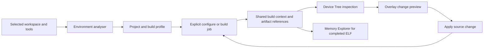

# Zephyr Project Creator and environment analyser master plan

Status: P0 foundation, P1 environment analysis and P2 minimal application creation with
explicit configure/build actions are implemented on 2026-11-04. Build Inspector
(`inspector`) provides advanced read-only build/resolved-tree inspection, current source
and binding/include navigation, including application sources before configuration.
A verified image handoff to Memory Explorer is also available.
P4 named configurations and fragment selection, and the first P5 slices (a Minimal C++
starter and curated local sample cloning), are also available. The first P7 custom-board
slice adds persistent root management and reviewed reference-port scaffolding, with a
supported-SoC filter. Further editor work and advanced composition remain
planned. The agreed first creation priority is
**new applications inside the existing `zephyrproject` workspace**.

Product direction update on 2026-11-05: the delivered everyday creator workflow is the
basis for the next feature, the [Device Tree Editor](device-tree-editor-masterplan.md).
Its D0–D15 plan now supplies the detailed interaction design and implementation prompts.
Advanced creator/composition work below remains separate; this does not mark all P0–P7
work complete.

Earlier direction on 2026-11-04: finish the ordinary Project Creator workflow
first, with sidebar guidance for Applications, Create application and Environment.
Inspection belongs in the separate optional Advanced area. Device Tree Editor
(`devicetree`) is reserved for a future visual overlay editor with hardware modules and
pin assignment; its detailed interaction design is now in the editor master plan. Further inspection depth
is deferred and is not the automatic next task. See [ADR 0009](decisions/0009-project-navigation-and-inspector.md).

Delivered records are `EnvironmentSnapshot` version 1, feature-owned version-1
project and attempt records, and version-2 profiles (with version-1 compatibility).
The creator is Linux only, minimal C/C++ or a curated local sample, one image and an explicit installed GNU
SDK. P3 adds a narrow transient build-observation
contract; the full editor/change-plan contracts remain future work. See the
[build inspection guide](build-inspection.md), [environment analyser guide](environment-analyser.md),
[Project Creator guide](project-creator.md),
[ADR 0003](decisions/0003-environment-observations.md) and
[ADR 0004](decisions/0004-reviewed-project-creation.md) for implemented behaviour and limits.

Build a small project creator on top of an environment analyser that discovers what
the selected Zephyr installation actually supports. Extend it into configuration,
devicetree editing, and environment migration in separate releases. Generated projects
must remain ordinary Zephyr applications that also work without Zephyr Utilities.

## Recommended scope

The first creator release should select the existing workspace and its environment,
offer a searchable board target and installed toolchain, generate a minimal application
after a file preview, and optionally configure/build it through an explicit action.
It should record enough build context for the Device Tree Editor to open the same
application, target, and image later.

| Approach | Value | Cost and limitation | Recommendation |
| --- | --- | --- | --- |
| Fixed templates and a bundled board list | Fast demonstration | Becomes stale; misses local boards, forks, qualifiers and SDK differences | Avoid as the product foundation |
| Local analyser with a focused creator | Useful immediately; follows the selected checkout | Requires bounded discovery, capability adapters and provenance | Build first |
| Complete graphical project and hardware workbench | Broad editing and lifecycle coverage | Kconfig, devicetree, multi-image builds, SDK management and hardware ports each need substantial validation | Grow through independently useful stages |

The simple interface and the complete model can coexist. Show a short creation flow
first; expose advanced options only when supported. Unknown or unsupported combinations
must remain visible with an explanation, rather than disappearing or receiving a false
compatibility guarantee.

## Current application and research baseline

The utilities provide one server, workspace selection, feature registration,
authenticated APIs and cancellable jobs. `core/workspace.py` validates a directory;
feature-owned environment analysis now lives in `features/projects/`. Memory Explorer discovers
existing builds and sysbuild domains, but its discovery implementation belongs to
`features/memory/`. Projects must not import that private implementation. See
[architecture](architecture.md) and [the feature guide](adding-a-feature.md).

The inspected local Zephyr checkout identifies itself as
`v4.4.2-103-gfbab2f598d5`, commit
`fbab2f598d545ad043ce50a75fefa4550b053f0b`, with `VERSION` reporting 4.4.2 and
`SDK_VERSION` containing 1.0.1. These are observations of this checkout, not a claim
about the newest release or the SDK actually installed or used by an existing build.
Official online documentation below uses moving `latest` URLs; runtime decisions
must use the selected checkout and verified capabilities.

Two local examples show why version-aware discovery matters:

- `scripts/west_commands/boards.py` exposes revisions, qualifiers and expanded targets;
  a simple board-name list would lose useful selection information.
- `scripts/west_commands/sdk.py` supports GNU/LLVM choices and deprecates older
  toolchain flags. Its installed SDK layout handling includes both earlier layouts and
  SDK 1.x. A command copied from another release may be wrong for this checkout.

## Zephyr workflows to accommodate

Zephyr distinguishes applications inside its source repository, elsewhere in its west
workspace, and outside that workspace. A minimal application connects source files and
configuration to the Zephyr CMake build system. The first release should create the
workspace form, outside `zephyr/` and outside `zephyr-utilities/`.
See [application development](https://docs.zephyrproject.org/latest/develop/application/index.html).

Application location is separate from dependency ownership. A workspace may use
Zephyr's manifest, an application-owned manifest, or a separate manifest repository.
Creating a local application need not add it to `west.yml` or change that topology.
See [west workspaces](https://docs.zephyrproject.org/latest/develop/west/workspaces.html).

| Area | Useful capabilities | Planned delivery |
| --- | --- | --- |
| Application starting point | Minimal C application, later C++, curated local samples, template provenance and requirements | P2 minimal; P5 expansion |
| Existing applications | Open without moving files, inspect profiles/builds, preserve custom CMake and configuration | P3 inspection; P4 edits |
| Locations and manifests | Existing workspace first; freestanding applications; application-owned or separate manifests; pinned dependency export | P2 first case; P5 others |
| Target hardware | Board/vendor search, SoC family and chip filters, exact revision/qualifier selection, local board roots | P1 inventory; P2 selection |
| Software configuration | Kconfig fragments, board/SoC configurations, named debug/release profiles, dependency diagnostics | P2 basic `prj.conf`; P4 profiles |
| Hardware configuration | Source overlays and bindings, resolved tree, aliases/chosen nodes, peripheral settings, pinctrl and partitions | P3 inspection; P4 bounded edits |
| Reusable composition | Shields, snippets, modules, custom bindings/drivers/libraries, configuration directories and packages | P1 module/root inspection; P5 component catalogues and authoring |
| Toolchains | Discover installed SDKs and other toolchains, identify selection, architecture coverage and effective compiler | P1 inspection; P2 explicit installed selection |
| Build lifecycle | Configure, compile, logs/cancellation, distinct build directories, artifact handoff | P2 single image; P5 sysbuild creation |
| Environment evolution | Rescan new boards/chips, compare installed environments, diagnose removed targets/options/bindings, deliberate upgrade trials | P1 refresh; P6 comparison and migration |
| Custom hardware | Registered custom roots and reviewed reference-port scaffolds; explicit hardware customization remains separate | P1/P2 discovery; first P7 slice available |
| Testing and devices | Twister recipes, native/simulator builds, build matrices, then runner-specific flash/debug actions | P7, with selected smoke builds earlier |
| Downstream consumers | Open completed builds in Memory Explorer; later model/run provenance for TinyML | P3 artifact integration; later research work |

A reference for advanced repository layout is Zephyr's
[example application](https://github.com/zephyrproject-rtos/example-application), which
demonstrates modules, custom boards, drivers, bindings and tests. Use a revision
appropriate to the selected environment; copying its development branch is not a
universal template for older releases.

## Environment analyser

### Questions it should answer

1. Which workspace, Zephyr checkout and Python/tool environment will this operation use?
2. Which board targets, SoCs, revisions, shields and snippets are available here?
3. Where did each item come from, and what is missing or conflicting?
4. Which installed SDK/compiler is selected, and what evidence supports compatibility?
5. What changed since the previous analysis or between two selected environments?
6. Which facts are only declared in metadata, and which were confirmed by configuration
   or a completed build?

### Discovery layers

| Layer | Inputs and output | Limits |
| --- | --- | --- |
| Workspace identity | Selected root, west top directory, manifest location/imports, active projects, actual Git revisions and dirty state | Manifest revisions describe intent; checked-out commits describe current sources |
| Zephyr and tools | Zephyr base/commit/version, Python executable, west/CMake/Ninja/dtc versions, supported command options | Preserve the venv interpreter path; do not resolve it into the system interpreter |
| Hardware and components | Selected-tree board/SoC metadata, module roots, explicit additional roots, snippets/shields, local template metadata | Static discovery can be incomplete when application CMake supplies roots dynamically |
| Installed toolchains | SDK locations/version metadata, compiler paths, installed target toolchains, relevant environment overrides | Available package contents and installed contents differ; never infer installation from `SDK_VERSION` |
| Configured context | Explicit configure output, effective board/toolchain, inputs, `.config`, DTS, domains and diagnostics | Configuration executes project/tool code and writes a build directory |
| Completed build | Artifact hashes and effective recorded metadata linked to a build attempt | Compilation does not establish functional or electrical correctness |

West projects and Zephyr modules are different sets. Account for active west projects,
module declarations, extra modules, replacement module lists, and roots supplied by
modules. Keep root order and origin. Report unresolved imports or missing modules
without fetching them during analysis.
See [module discovery and build settings](https://docs.zephyrproject.org/latest/develop/modules.html).

### Adapters and evidence

Prefer the selected environment's supported discovery interfaces, such as `west boards`,
with capability checks before using optional fields. Parse structured local metadata
through versioned adapters where no stable machine interface exists. Do not assume
human-readable CLI output is a stable JSON API or import arbitrary checkout modules
into the utilities process. Invoke selected tools in bounded subprocesses.
See [Zephyr extension commands](https://docs.zephyrproject.org/latest/develop/west/zephyr-cmds.html).

Each analysed field should retain its source file or command, environment identity,
observation time and evidence level. Suggested states are `declared`, `discovered`,
`configure-validated`, `build-validated`, `hardware-validated`, `unknown` and
`unsupported`. State applies to a particular claim and configuration, not to an entire
board for all purposes. Keep diagnostics and raw relevant output alongside normalized
records, with bounded sizes and no full environment dump.

Use version information to choose candidate adapters and capability probes to verify
them. Vendor forks, backports and development checkouts may not match upstream release
assumptions. An unknown metadata schema should produce partial read-only results and
disable affected writes. It must not trigger a guessed conversion.

### Refresh and offline behaviour

Cache the catalogue by environment identity, adapter/schema version, active module and
ordered root sets, and discovery input fingerprints. Fingerprints need to notice file
additions/deletions and dirty/untracked metadata, not just changes to Git HEAD. Detect
replaced SDK/compiler paths and changed selection overrides too. Use cheap incremental
checks and an explicit full rescan with visible progress, limits and cancellation.
If inputs change during a scan, retry the affected part or mark that snapshot stale.

After an external Zephyr update, a new board or chip becomes available after rescan if
its schema is supported. Show added/removed/changed items; preserve old snapshots and
profiles. A removed target becomes unresolved rather than silently retargeting a project.
Invalidate stale validation whenever relevant inputs change, and recheck fingerprints
before executing a previewed operation. Capture inputs when submitting a job.

Keep normal discovery offline. Bound traversal to selected roots, avoid symlink loops,
limit file sizes/process durations and explain partial scans. No automatic `west update`,
SDK download, dependency installation, checkout change or mass configuration of every
board. An explicit configure/build job is separate from inspecting metadata.

The local documentation catalogue generator, `doc/_scripts/gen_boards_catalog.py`,
derives richer board information using configure results. This reinforces the separation
between a fast metadata inventory and an explicitly validated application/target.

### SDK and version selection

Treat the Zephyr source revision, west/modules, Python environment, SDK installation,
toolchain variant and compiler as separate identities. A Zephyr upgrade can change the
board catalogue; selecting another SDK changes compiler/tool support and does not itself
add Zephyr board definitions. Multiple SDKs may coexist. Compatibility depends on the
selected release, host, target architecture and installed components.
See [Zephyr SDK](https://docs.zephyrproject.org/latest/develop/toolchains/zephyr_sdk.html).

The analyser should distinguish the recommended/default SDK reference, declared
constraints, detected installations, requested selection and effective compiler recorded
after configuration. Start with the current environment and explicitly selected installed
Zephyr SDKs. Recognize other toolchain variants and report what can be verified; defer
their guided setup to adapters with real demand.

Identify each SDK by its installation path and content/tool fingerprint as well as its
version. Equal-version installations may contain different target toolchains or local
changes. The inspected `west sdk list` implementation keys entries by version, so use
explicit-path inspection and supported search locations to retain candidates it may
collapse. Do not treat that command's output as an exhaustive installation identity map.

Apply per-profile environment settings to subprocesses, without modifying shell startup
files or a global default. The configure result must confirm the requested selection;
stop on an unexpected Zephyr base/compiler. New board, Zephyr or SDK selections use a
fresh build directory by default. CMake retains its initial Zephyr package selection
across incremental builds; see
[Zephyr package selection](https://docs.zephyrproject.org/latest/build/zephyr_cmake_package.html).

## Board and chip selection

Offer two entry paths: search for a board, or search for a chip/SoC and then choose a
board target using it. The result must be a buildable target description. A bare chip
selection cannot supply board wiring, clocks, memory layout and peripheral routing.
If there is no suitable board port, offer an explanation and the later custom-board
workflow rather than inventing a generic board.

Keep the upstream target string and its components. Hardware model v2 targets can
include a board revision and qualifiers selecting a SoC, CPU cluster or variant.
Defaults, aliases, revision rules and valid combinations must come from the selected
tree. Do not construct an arbitrary Cartesian product or collapse a multicore board
into a chip name. See the
[board porting guide](https://docs.zephyrproject.org/latest/hardware/porting/board_porting.html).

The selection view should show:

- Board name and vendor, source root/module and whether it is local or upstream.
- SoC identifier/family, architecture, exact target, requested revision and any resolved
  revision/default; unsupported or ambiguous values need a specific diagnostic.
- Available qualifiers with their upstream descriptions. Do not guess that every
  qualifier is a CPU core or that a nonsecure variant stands alone.
- Declared features, required SDK architecture and runner metadata when available, with
  separate checks for installed tools and a connected device.
- Template requirements, such as an LED alias for blinky, and whether those requirements
  are declared or verified in the resolved configuration.

Board metadata can help filter by memory or peripherals, but advertised chip capacity
is not application capacity. Missing values stay unknown. External memory, bootloader
partitions, security reservations and image sharing require the selected configuration.
Likewise, a peripheral declaration does not prove a particular pin is available or a
shield is electrically compatible. Host/simulator targets should be labeled clearly.

Board extensions can add variants to an existing board across multiple source directories;
preserve all contributing origins. Distinguish those supported extensions from genuine
duplicate definitions. Duplicate names need visible origin and the selected resolver's
precedence; expose conflicts rather than quietly choosing a directory. Supporting existing
custom board/SoC roots is much smaller than implementing a new SoC port; the latter can
require architecture, HAL, clock, interrupt and driver work beyond this creator.
See [SoC porting](https://docs.zephyrproject.org/latest/hardware/porting/soc_porting.html).

## Project model and creation workflow

Separate persistent application identity from a build profile and a concrete build
attempt. An application may have several boards, SDKs or debug/release profiles, each
with its own build directory and history. Preserve both requested options and effective
configured values; they need not be identical.

Suggested first flow:

1. **Environment**: confirm the existing workspace and analysed Zephyr/toolchain context.
2. **Application**: name and destination, defaulting to `<workspace>/applications/<name>`.
   Permit another explicit directory within the workspace outside dependency/tool trees.
3. **Target**: select an exact board target; show required choices and evidence.
4. **Template**: start with a minimal C application requiring no board-specific LED or
   sensor. Offer blinky only when its requirements are checked.
5. **Preview**: show every generated file, destination, profile and intended command.
6. **Create**: apply the reviewed files without overwriting an existing application.
7. **Configure or build**: optional explicit jobs, with logs, cancellation and results.

Initial files should be small and recognizable: `CMakeLists.txt`, `prj.conf`,
`src/main.c`, an appropriate `.gitignore`, and a README with reproducible commands.
Create overlays only when requested or needed by the template. Do not hardcode the
board into otherwise portable source. Store template version, file hashes and local
profile records in `context.feature_data("projects")`; profiles must not be required
for command-line builds. Add portable recipe export later, separating relative project
paths from machine-local tool locations.

Preview/apply should use a versioned change plan with expected file hashes, destination
identity and environment fingerprint. Validate names, paths and symlink containment;
reject existing destinations in the initial creator. Stage new files and commit without
clobbering a directory that appeared after preview. On failure, clean up only files
owned by that operation. Later editing needs conflict detection, bounded patches and
recoverable originals rather than regenerating an existing application wholesale.

Configure and compile are distinct job outcomes. Show the argument array, working
directory, effective environment selections and separate build output path. Use explicit
source/target/build arguments instead of inherited west defaults. Do not interpret an
argument as shell syntax. Build-directory changes require either a new directory or a
deliberately requested pristine operation, never silent deletion. The upstream build
interface and its configuration options are described in
[building with west](https://docs.zephyrproject.org/latest/develop/west/build-flash-debug.html).

Local sample cloning must preserve licenses and required supporting files. Some samples
depend on sibling sources, modules, blobs or specialized hardware. List those requirements
and reject an unsupported copy; a directory copy is not proof of a standalone template.
Later presets may cover logging, shell, UART, sensors, networking/BLE, storage, tests and
TinyML, but each needs versioned requirements and a bounded validation matrix.

## Device Tree Editor connection

The [Device Tree Editor master plan](device-tree-editor-masterplan.md) now defines the
editing workflow, source synchronization, proposed contracts and implementation stages.
The context and provenance requirements below remain applicable.

A resolved devicetree belongs to a configured application, board target, configuration
and image/domain. Selecting a board alone provides source browsing, not the final tree.
Kconfig controls software choices while devicetree describes hardware; both participate
in the build. Enabling a node is not proof its driver is enabled or linked. See
[devicetree versus Kconfig](https://docs.zephyrproject.org/latest/build/dts/dt-vs-kconfig.html).

### Proposed shared contracts

`EnvironmentSnapshot` version 1 is a feature-owned observation record; its exact fields
are in the [environment contract](environment-analyser.md). P2 also implements a narrow
feature-owned project/profile, reviewed plan and attempt context, documented in the
[creator contract](project-creator.md). The full cross-feature records below remain
design proposals; neither attempt records nor the initial P3 observation satisfies every
proposed field or freshness guarantee. The implemented read-only shared interface is
documented in [ADR 0005](decisions/0005-read-only-build-inspection.md): output identities
are revalidated while source freshness remains unknown.

| Record | Minimum contents | Purpose |
| --- | --- | --- |
| `EnvironmentSnapshot` | Workspace/Zephyr identity, tools, modules/roots, capabilities, fingerprints and evidence | Pin discovery and execution to the same environment |
| `ProjectSpec` and `BuildProfile` | App/config directory, template provenance, requested target/toolchain, ordered configuration inputs, build mode | Describe an intended build independently of its result |
| `BuildContext` | Profile/attempt ID, effective board and revision/qualifiers, toolchain, resolved input paths/order/hashes, build directory, image/domain and freshness | Give Projects and the editor the same context |
| `ArtifactRef` | Artifact kind/path/hash, producer attempt/domain, provenance and availability | Refer to DTS, config, ELF, map and related outputs without sharing private storage |
| `ChangePlan` | Destination/expected hashes, proposed file changes, originating context, diagnostics and validation result | Review and apply source edits with stale-input protection |

Profiles must retain automatic-versus-explicit selection, ordered `CONF_FILE`,
`EXTRA_CONF_FILE`, `DTC_OVERLAY_FILE` and `EXTRA_DTC_OVERLAY_FILE` values, plus
`FILE_SUFFIX`, configuration directory, shields, snippets and root/module overrides.
Capture command arguments, working directory and relevant environment selections with
each attempt. Resolving an automatic input must not silently convert it to an explicit
override in the saved recipe.

Artifact references also need a lifetime policy. Recheck hashes when opening a live
build path: another configure/build can overwrite it. Retain immutable copies when
durable evidence is needed; otherwise mark an older reference replaced or unavailable.
Never show a new file under an earlier attempt's provenance.

Add narrow shared interfaces in `core/` when implemented consumers actually need
them, assembled by `app.py`. Generation remains in `features/projects/`; advanced
inspection lives in `features/inspector/` and the future visual editor belongs in
`features/devicetree/`. No feature imports another's
private services. Do not move Memory Explorer wholesale; extract only reused metadata
reading at the integration stage and preserve its existing behaviour and snapshots.

### Source inputs and resolved outputs

Preserve the effective ordered source list, including board/revision and board-extension
inputs, application overlays, shield overlays, snippets, include paths and module/custom
binding roots. Include transitive DTS and binding dependencies in freshness checks;
changing an included `.dtsi` or binding matters even if the overlay is unchanged. Use
selected-tool dependency information and mark freshness uncertain when coverage is partial.
`DTC_OVERLAY_FILE` can replace automatic application overlay discovery;
`EXTRA_DTC_OVERLAY_FILE` appends additional overlays with later precedence. Resolve the
actual order using the selected build system, including configuration-directory and
file-suffix rules, instead of implementing a simplified second resolver.
See [devicetree overlay selection](https://docs.zephyrproject.org/latest/build/dts/howtos.html#set-devicetree-overlays).

Read `zephyr.dts.pre`, `zephyr.dts`, generated headers, `.config`, `CMakeCache.txt`, `build_info.yml` and
`domains.yaml` when present through capability-aware readers. Generated paths vary;
absence should yield a partial context. Generated DTS and config are inspection evidence,
not durable editing destinations. Do not load imported `edt.pickle` with Python pickle;
use text artifacts or a controlled selected-tool adapter returning data.
Preprocessor line information can support source navigation. Apply a defined read-root
policy to source includes and binary includes instead of following arbitrary file paths.

Bindings describe property types and constraints and can support later forms. Preserve
comments and source expressions such as macros and phandles rather than reconstructing
source from a flattened tree. Where source attribution cannot identify the contributing
file precisely, say so and let the user choose the overlay destination.
See [devicetree bindings](https://docs.zephyrproject.org/latest/build/dts/bindings-intro.html).

### Editing and validation sequence

1. Open a build context from Projects or select an existing build in the editor. Display
   its application, exact target, environment, image/domain and freshness.
2. Start with read-only tree, property, binding and source navigation.
3. Add a bounded set of edits to an application overlay, showing a diff and any required
   software configuration changes separately. Include raw text editing as an escape
   hatch; forms must not discard unsupported properties.
4. Validate the candidate in an explicit isolated configure job with the same context.
   Supported validation must preserve relative include/module paths. If arbitrary CMake
   prevents faithful staging, require a documented user-directed validation workflow
   rather than claiming equivalence or modifying live sources temporarily.
   Separate output directories do not sandbox project CMake or selected tools.
5. Apply only against unchanged source hashes. Keep failed validation and diagnostics
   attached to the candidate. Editing changes source state; old artifacts remain marked
   stale until a new configuration/build succeeds.
6. Offer compilation as a separate stronger check. Compilation still does not verify
   pin routing, voltage, external wiring or peripheral operation on hardware.

Kconfig fragments need analogous handling: compare requested assignments with effective
`.config`, expose unmet dependencies and save durable changes into chosen fragments.
Do not promote every symbol in generated `.config` to an application setting. See
[setting Kconfig values](https://docs.zephyrproject.org/latest/build/kconfig/setting.html).

Sysbuild needs one context per image plus its parent relationship. Opening an application
overlay must not edit the bootloader or another core's image. Sysbuild has its own
configuration and per-image namespaces; a domain is not inherently a CPU core.
See [sysbuild](https://docs.zephyrproject.org/latest/build/sysbuild/index.html).

## Staged delivery and exit gates

Stages are capability boundaries, not calendar estimates. P0/P1 provide environment
analysis and P2 delivers the first creator workflow. P3 inspection and Memory handoff are
available; remaining P3 work and P4 expand editor integration. P5 through P7 are optional
expansion based on actual projects.

| Stage | Outcome | Status | Depends on | Relative scope |
| --- | --- | --- | --- | --- |
| P0 | Observation contract, capability policy and synthetic fixtures | Available | Existing platform | Small |
| P1 | Offline environment analyser and target catalogue | Available | P0 | Medium |
| P2 | New workspace application and explicit single-image build | Available within documented limits | P1 | Medium |
| P3 | Existing-build inspection and tool handoffs | Device Tree, Memory, current source/binding navigation and pre-configuration browsing available; deeper attribution pending | P2; editor reader | Medium |
| P4 | Reviewable configuration and overlay editing | Named configurations and fragment selection available; source/visual editing deferred | P3 | Large |
| P5 | Reusable components and advanced project layouts | C++ starter and curated sample cloning available; further composition planned | P2; P4 for integrated editing | Large, split into slices |
| P6 | Environment comparison and upgrade trials | Planned | P1/P2; later stages for their profiles | Medium to large |
| P7 | Custom board assistance and testing/device workflows | Root management and reference scaffolding available; hardware editing, testing/device workflows planned | P4/P5 | Large, separate workflows |

### P0 Define the first supported contract

Delivered: feature-owned `EnvironmentSnapshot` schema version 1, the metadata-versus-build
evidence boundary, documented Linux host scope, and bounded adapter behaviour. Synthetic
fixtures cover hardware model v2 shapes used by Zephyr 3.7 and 4.4, a backported extension,
and legacy/unknown metadata that degrades safely. This is metadata-shape coverage; it
does not establish builds on both releases. The current local checkout is the integration
reference. The shared editor contracts remain deferred; P2 profiles are feature-owned.

Exit gate: fixture definitions cover qualified/revisioned targets, missing SDKs/modules,
custom roots, valid board extensions versus duplicate definitions, equal-version SDKs
at different paths, changed metadata without a new commit, malformed files, and a stale
observation. Schema tests cover initial version 1 and rejection/preservation of unknown
future formats. There is no older environment format to migrate. The persistence and
boundary decision is recorded in [ADR 0003](decisions/0003-environment-observations.md).
Future schemas still require migration cases before persistence changes ship.

### P1 Deliver the analyser

The delivered Environment view under Projects shows the selected workspace, tool availability,
Zephyr identity, installed SDK choices and a searchable board/SoC catalogue with origins.
It includes explicit extra roots, incomplete-discovery diagnostics, fingerprinted catalogue
reuse, refresh and cancellation. SDK entries are installed candidates, not build-toolchain
selection. Reopening serves saved observations without a watcher or automatic rescan.

Exit gate: offline refresh discovers an added synthetic board without editing utilities
code; changes between two fixture environments invalidate the relevant cache; missing
tools give useful partial results; unsupported schemas cannot produce a supposedly
validated target. A board extension adds its qualifier with contributing origins intact,
and explicit-path SDK inspection retains two equal-version installations. Scanning
changes no firmware inputs, repositories or tool installation.
The Environment view remains analysis only; P2 creation and execution are separate
reviewed actions. Dynamic CMake-derived roots, configuration validation,
binding/shield/snippet catalogues and legacy hardware support remain outside the
analyser's discovery scope.

### P2 Deliver the first Project Creator release

Delivered: the seven-step flow for a minimal C application inside the existing workspace,
exact discovered target and explicit installed GNU SDK. Every generated file is reviewed;
publication cannot replace an existing destination. The application README provides
independent direct CMake commands. Configure and Build require separate exact-command
reviews, run as shared cancellable jobs and use fresh output directories. Requests capture
their workspace and selected environment. Feature-owned version-1 project/profile and
attempt records preserve commands, source hashes, outcomes, partial context, bounded logs
and live artifact identities. No flashing is included.

The supported slice is Linux, a resolved existing west workspace with a nonempty resolved
module list, one minimal C application/image and GNU SDK selection. Source paths with
whitespace are rejected to match Zephyr's build-system limitation. Automatic configuration
packages are disabled; ordinary application configuration/overlay discovery stays with
Zephyr. Profile editing/migration, sample import and sysbuild creation remain later work;
P3 adds handoff from an existing build to Device Tree and Memory. See the [creator contract](project-creator.md) and
[ADR 0004](decisions/0004-reviewed-project-creation.md).

Exit gate: generate/configure/build with a real local target and SDK, independently run
the displayed recipe, and exercise collision, traversal, symlink-change, whitespace,
cancellation and partial-failure cases. Verify workspace switches and leaving/reopening
cannot redirect or cancel active jobs. Only one actual SDK is available in the local
integration environment; separate installed-SDK selection has fixture coverage. Real
integration evidence is recorded in the creator guide without claiming all discovered
targets or hardware operation.

Stop here when the immediate need is reliable new-project creation. The next stage does
not require a graphical Kconfig editor, network installation or a custom-board wizard.

### P3 Connect existing builds and Device Tree inspection

Delivered slices: explicit existing-build opening, metadata/artifact inspection,
sysbuild domain selection and a shared observation handoff to a read-only resolved DTS
node/property reader. Changed or missing outputs retain their original identity and
require re-inspection; source freshness remains unknown. No tools execute during
inspection. Memory handoff carries the same selected image/ELF into an explicit report
review, with revalidation before tool execution and snapshot publication. Saved Memory
formats and manual workflows are preserved. See [scope and limits](build-inspection.md).
Source catalogues now list recorded inputs and preprocessor source references, with
bounded read-only file/include navigation inside the selected workspace. Binding search
shows current compatible candidates separately from supported generated-header path
records. YAML/include/property browsing does not merge or validate effective schemas.
Application source browsing is also available before configuration, with workspace-bound
directory/file identity checks and explicit conventional include locations. It requires
no inspection ID, generated outputs or saved creator profile, and claims no effective target.

The stage's target remains:

Open an existing application/build without changing its files. Share the minimal build
context and artifact interface with the Device Tree reader. Offer source browsing before
configuration and a clearly labeled resolved view afterward. Recognize existing sysbuild
domains even before creating multi-image projects. The delivered Memory handoff analyzes
completed ELF artifacts without rebuilding firmware.
Deeper per-property source attribution remains a separate slice; current file links do
not prove which source expression contributed a resolved value.

Exit gate: Projects and Device Tree show the same target, overlay inputs and domain;
two builds of one application remain distinct; stale or missing artifacts are explicit;
switching between images and leaving/reopening either tool preserves selection correctly.
Memory's current snapshots and compatibility endpoints still pass regression checks.

### P4 Add controlled configuration editing

Everyday management is available: reviewed import and folder reconnection, editing
named/Original build selections, optional board-matched default-overlay creation,
verified incremental output reuse and reviewed cleanup with retained history. See
[ADR 0017](decisions/0017-project-management-and-build-outputs.md).

First slice implemented: saved applications have named exact-target/installed-SDK
configurations. Saving writes metadata only; Configure/Build reviews and executes the
selected captured profile in fresh outputs. Original project profiles and earlier
attempts remain readable without migration. See
[ADR 0010](decisions/0010-named-build-configurations.md).

Second slice implemented: named configurations select ordered app-local Kconfig and
overlay files with independent automatic, append and replacement modes. Source contents
stay unchanged, current files are checked for each review, and version-2 profiles prevent
older readers silently ignoring selections. See
[ADR 0011](decisions/0011-ordered-application-fragments.md).

Remaining slices: source overlay
editing with diff; diagnostics from candidate configuration; then a limited binding-based
property form. Preserve independent source edits, unknown expressions and comments.
Expose software dependency failures beside hardware changes.

Exit gate: change an application peripheral/alias in a test fixture, validate the
candidate, apply the reviewed patch, and observe the new resolved tree. An invalid
phandle, missing binding, conflicting pin choice where detectable, unmet Kconfig
dependency and concurrent file edit produce appropriate diagnostics without corrupting
source. Rollback restores only this operation's changes and never overwrites later edits.
Hardware checks remain separately labeled.

### P5 Add advanced project composition

First slice implemented: an explicit Minimal C++ starter alongside Minimal C. The
trusted built-in template catalogue controls the reviewed source files and retained
template identity. C++ uses `main.cpp`, C/CXX CMake languages and `CONFIG_CPP=y`, with
the existing destination checks and separate Configure/Build workflow. Earlier clients
that omit template selection still receive the original C template. This does not
convert existing applications.

The local sample slice copies supported Hello World, Blinky and Button trees from the
selected checkout. A bounded adapter checks the local CMake/source/license layout and
preserves upstream supporting files, board overlays and origin hashes. Unsupported
layouts or changed source inputs block creation; no sample build code runs during
discovery/preview. The existing Configure/Build flow validates a copied app explicitly.
See [ADR 0012](decisions/0012-reviewed-local-sample-cloning.md) for the source and
publication boundaries. General sample discovery and additional adapters remain planned.

Prioritize remaining use cases independently: more sample adapters; snippets and
shields; module/custom-driver/binding roots; freestanding applications; portable profiles
and manifest-owned workspaces; then sysbuild with explicit per-image configuration.
Show ordered additions from each component, rather than hiding them behind checkboxes.

Snippets can append configuration and overlays in an ordered sequence. Shields describe
add-on hardware and may impose connector/configuration requirements. Neither is a
guarantee that any combination works. See
[using snippets](https://docs.zephyrproject.org/latest/build/snippets/using.html),
[snippet composition](https://docs.zephyrproject.org/latest/build/snippets/writing.html)
and [shields](https://docs.zephyrproject.org/latest/hardware/porting/shields.html).

Exit gate per slice: a representative project builds outside the utilities, manifests
and licenses are retained, unsupported compositions are explained, and profile export
does not depend on the creator's absolute machine paths. Sysbuild tests must retain
parent/domain identity and prevent cross-image writes. Defer bootloader signing-key
management and production provisioning to separately scoped work.

### P6 Compare environments and assist upgrades

Compare two locally analysed environments: boards/qualifiers/revisions, metadata schemas,
modules, toolchains, selected bindings and configured Kconfig differences. Suggest
possible rename/migration actions only with evidence. A successful scan of a newer
checkout does not establish that the project migrates successfully.

Create a candidate profile and isolated build output while preserving the original
environment/profile/artifacts. Resolve target/module changes, run explicit configure and
build trials, and present diagnostics plus DTS/config/artifact differences. Optional
workspace creation and SDK/dependency installation are later explicit network/write
operations with a preview of destinations and revisions; they never run as a rescan.

Use frozen manifests for repository revisions when appropriate, but also record the
manifest repository commit, dirty/untracked inputs and toolchain identity. A frozen
manifest alone does not capture local source edits or the whole build environment.
See [west manifest freezing](https://docs.zephyrproject.org/latest/develop/west/manifest.html#freezing-manifests).

Exit gate: compare two supported environments, preserve a baseline, identify an unavailable
target and an SDK mismatch, and run a candidate build without changing the old checkout
or build directory. Reverting selects the retained profile; it does not depend on
reversing a destructive workspace update. Report application test results separately
from configuration/build success.

### P7 Assist custom hardware and validation

The first slice provides persistent custom-root registration, reviewed rename/reconnect
and removal, automatic root inclusion in analysis, and stale-selection protection.
The guided creator starts from an eligible local reference, directly or filtered by
supported SoC. It publishes reviewed board files without replacement and retains source
and license provenance. Clock, memory, console, pins, revisions and runners are inherited
from that reference and explicitly require hardware review. See [custom boards](custom-boards.md).

Further work can add board-port customization using an already supported SoC, with explicit clock, memory,
console, revision, pinctrl and runner choices. Let the editor work on the custom port
only when that destination is selected. Start from version-matched schemas/reference
ports and keep all generated files reviewable. A new silicon/SoC port remains an expert
development workflow, not a promised one-click operation.

Separately add Twister/build-matrix recipes, test skeletons, simulation and CI export.
Device operations can follow through selected runners, explicit device selection and
separate flash/debug actions. Preserve image/ELF identity in test results. See
[Twister](https://docs.zephyrproject.org/latest/develop/twister/index.html).

Exit gate per workflow: a custom supported-SoC board port configures/builds; representative
tests distinguish build-only, simulator and physical-device results. Flashing requires
its own exercised device/error/cancellation path. No hardware capability is labeled
validated without recorded hardware evidence.

## Verification strategy

Normal tests must run without a network, SDK or physical board. Use small synthetic
fixtures for discovery schemas and filesystem/process failure cases. Keep separate,
explicit integration tests against installed Zephyr environments; do not check real
firmware artifacts, private project sources, models or device captures into Git.

| Boundary | Required evidence as that capability is implemented |
| --- | --- |
| Analyser | Missing/malformed metadata, supported version differences, unknown versions, root precedence, symlink limits, offline operation, stale cache and dirty/untracked changes |
| Toolchain selection | Missing target compiler, multiple SDKs, conflicting overrides, observed-versus-requested compiler, new build directory after selection change |
| Creator and editor writes | Exact preview/apply equivalence, collisions and races, path containment, stale hashes, partial failure cleanup and cancellation |
| Build resolution | Automatic and explicit config/overlay lists, shields/snippets, custom roots, meaningful Kconfig/DTS failures, configure versus compile outcomes |
| Cross-feature context | Two profiles and domains, transitive include changes, overwritten build artifacts, no cross-image writes, Memory Explorer compatibility |
| UI and jobs | Loading/empty/partial/error states, keyboard use, safe imported text, workspace switches, leave/reopen, no duplicated listeners or abandoned jobs |
| Packaging and schemas | Installed browser assets, versioned records, migration fixtures and preservation of older evidence |

Follow [contributing](../CONTRIBUTING.md): run focused checks during implementation,
then `python scripts/check.py --quick` and `python scripts/check.py` in the development
environment. Use `python scripts/verify_package.py` when adding/moving browser assets.
Report socket, SDK or hardware limitations precisely. The full P3 and later acceptance
gates still include future work. Environment discovery does not establish build success; configured
or compiled attempt evidence does not establish device operation. See the
[environment guide](environment-analyser.md) and [creator guide](project-creator.md) for
current supported scope, contracts and validation limits.

## Decisions for the next implementation task

The user selected **new apps in the existing workspace** as the first priority. The creator
uses Minimal C/C++ templates or curated local samples, `<workspace>/applications/<name>`, explicit installed GNU SDK
selection and one image per project profile. Analysis and previews do not download tools
or change firmware inputs. Profile/attempt persistence is versioned and feature-owned.

P0 through P2, P3 inspection and the Memory handoff are available. The shared observation
service now defines output freshness checks and read-root boundaries. Pre-configuration
browsing is available; deeper source attribution is deferred while Project Creator's
everyday workflow takes priority. Current-source
and binding navigation preserve existing creator and memory behavior. Do not treat output
identity or a current binding candidate as source/build consistency.
P4 provides named board-target/SDK configurations and ordered fragment selection.
P5 provides the C++ template and curated local sample cloning with license, provenance
and dependency checks. Further sample adapters or explicit snippet/shield selections
are candidates for later composition slices.
Defer visual hardware editing until the creator workflow is ready. For further P5/P7
work, prioritize actual needs such
as sensors, networking, custom boards or multicore builds. These later stages are context,
not authorization to implement them automatically.
